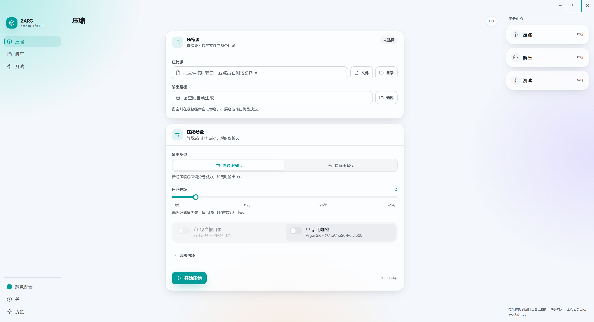

# ZARC

一款基于 Rust 开发的 Windows 解压缩工具，使用 Zstandard 压缩文件和目录。支持密码加密、分卷、自解压程序和压缩等级测试，压缩与解压均在本机完成。



## 功能

- **文件与目录压缩**：单文件保存为 `.zst`，目录或多选内容保存为 `.tar.zst`，压缩等级可在 1–22 之间调整。
- **密码加密**：使用 Argon2id 派生密钥，通过 XChaCha20-Poly1305 加密归档内容。
- **分卷与自解压**：按指定大小拆分普通压缩包，或生成双击后即可进入解压界面的 Windows EXE。
- **归档预览**：浏览目录结构、搜索文件名，查看文件数量、体积及 BLAKE3 摘要。
- **压缩等级测试**：比较样本在不同等级下的体积和耗时，将推荐等级一键应用到压缩页。
- **任务与外观**：查看进度、速度和剩余时间，支持停止任务；支持中英文、深浅主题和 256 种可搜索配色。

## 开始使用

1. 将 `ZARC.exe` 保存到本地，双击运行。
2. 在“压缩”页添加文件或目录，也可以一次拖入多个项目；文件清单支持添加、移除和清空。
3. 填写压缩包名称、选择输出目录和输出类型，按需调整等级、加密或分卷，再点击“开始压缩”。

多选内容会合并为一个压缩包或自解压程序。不同目录中的同名项目会自动编号，所有内容都会保留。

解压时，将压缩包拖入窗口，或在“解压”页选择文件，再点击“开始解压”。输出目录留空时，解压结果保存在压缩包所在目录；自解压程序也采用相同规则。

“关于 → 检查更新”会打开项目的 GitHub Releases 页面。

## 归档格式

| 用途 | 文件形式 |
| --- | --- |
| 单文件 | `文件名.zst` |
| 目录 | `目录名.tar.zst` |
| 加密归档 | `文件名.zst.enc` 或 `目录名.tar.zst.enc` |
| 分卷归档 | 在归档名后追加 `.001`、`.002` 等编号 |
| Windows 自解压 | `名称.sfx.exe`；大容量包附带 `名称.sfx.exe.payload` 数据文件 |

分卷文件保存在同一目录，解压时选择其中任意一卷即可。分卷大小在“高级选项”中设置，单位为 MiB。

分发自解压包时，将生成的 EXE 和附带的数据文件一并交付。接收方双击 EXE，填写密码（如有）后点击“开始解压”。自解压包支持加密，分卷功能用于普通压缩包。

## 常用设置

| 设置 | 默认值与作用 |
| --- | --- |
| 压缩等级 | 3；可根据所需体积和耗时调整 |
| 工作线程 | 0；按数据规模和可用核心自动分配，也可手动指定 |
| 压缩包名称 | 留空则自动命名，扩展名按输出类型确定 |
| 输出目录 | 留空则保存在第一个文件或目录旁，界面显示最终输出路径 |
| 包含根目录 | 默认关闭；开启后，目录归档会保留一层源目录 |
| 分卷大小 | 0；填写大于 0 的数值后按 MiB 分卷 |
| 写入日志 | 默认关闭；开启后记录压缩过程 |
| 完成后删除源 | 默认关闭；开启后在压缩成功后删除原文件或目录 |

颜色配置提供默认配色及 256 种颜色，可按名称或十六进制色值搜索。配色、深浅主题与界面语言会保留到下次启动；切换页面时保留当前表单和结果。

日志优先写入程序所在目录的 `zarc.log`，该目录不可写时使用系统临时目录。

## 性能测试

选择有代表性的文件或目录，点击“开始测试”。默认测试等级为 **1–19**，样本上限 **256 MiB**，每级先预热一次，再测量 **3 轮**并取均值，线程数自动分配。

文件样本来自头部、中部和尾部；目录样本覆盖整个文件清单，并按所选文件的体积分配。测试结果展示各等级的压缩后体积和吞吐量，点击“采用 L…”即可将推荐等级用于压缩。

## 系统要求

- Windows 10/11 x64。
- [Microsoft Edge WebView2 Runtime](https://developer.microsoft.com/microsoft-edge/webview2/)。
- 足够存放压缩或解压结果的磁盘空间。高等级压缩与大文件长距离匹配会增加内存占用。

## 从源码构建

需要 **Node.js 24 LTS**、**Rust stable（MSVC）**，以及 Visual Studio Build Tools 的“使用 C++ 的桌面开发”和 Windows SDK。环境配置参见 [Tauri Windows 前置依赖](https://v2.tauri.app/start/prerequisites/#windows)。

在 Windows PowerShell 中进入项目目录，运行：

```powershell
cd zarc-desktop
npm ci
npm run tauri:build:win
```

生成的程序位于 `zarc-desktop/src-tauri/target/release/ZARC.exe`，前端资源随 EXE 一同打包。

运行开发版本：

```powershell
npm run tauri dev
```

检查前端与 Rust 核心：

```powershell
npm run build
cargo test --manifest-path src-tauri/Cargo.toml --lib --locked
```

从 WSL 发起 Windows 构建时，先将源码复制到 Windows 磁盘上的独立目录，再在该目录中使用 Windows 版 Node.js 和 Rust 执行上述命令。

## 关于

作者：[Minayuki](https://github.com/Minayuki523) · [GitHub 仓库](https://github.com/Minayuki523/ZARC)

桌面界面采用 Tauri 2、Svelte 5 和 TypeScript，压缩核心使用 Rust、Zstandard 与 tar。项目采用 MIT 许可证，依赖组件遵循各自许可。
